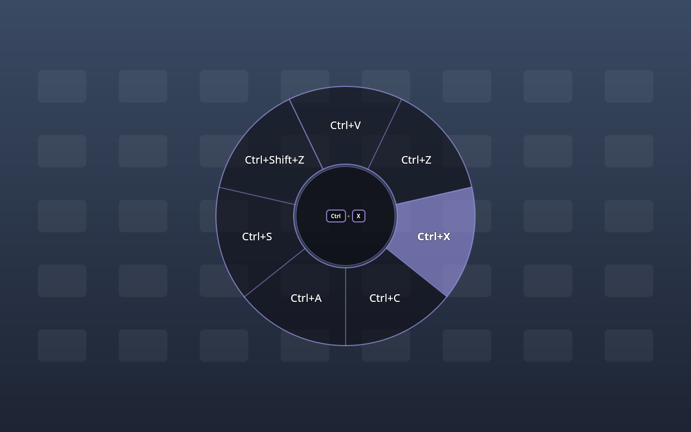

# deckhud

On-screen HUD for Steam Input in **KDE Plasma (Wayland) Desktop Mode** on the Steam Deck:

- **Radial menu HUD**: see which radial item you're selecting, as in Game Mode.
- **Key-chord toasts**: see which keys a button just sent (`[R4] → Meta + Shift + .`).
- **Layer cheat sheet**: see what every control does when you switch action sets or hold a layer,
  or on demand with `deckhudd peek`. Bind that command to a KDE shortcut, then map a Steam button to it.

Overlays are translucent and click-through, and follow your KDE accent colour live (via the settings portal), even with a wallpaper slideshow.

> Status: early development. See [docs/PLAN.md](docs/PLAN.md).

## How it works

`deckhudd` (Go) reads the Deck controller's raw HID reports passively alongside Steam. It also parses
your active Steam Input config, using Steam's `controller.txt` log to find it, and replays Steam's
activator/layer/radial logic. Events go over a token-protected loopback WebSocket to a QML overlay,
which runs on SteamOS's own Qt with LayerShellQt. Nothing touches the read-only root, and
nothing needs root.

## Try it

Requires [mise](https://mise.jdx.dev/) (for Go).

```sh
mise run build
./bin/deckhudd dump          # what deckhud thinks your current layout does
./bin/deckhudd monitor       # live button names / stick angles
./bin/deckhudd demo ui       # scripted preview of the overlay (no controller needed)
./bin/deckhudd run ui        # the real thing, from the source tree
./bin/deckhudd events        # no overlay; print events as JSON lines
./bin/deckhudd peek          # toggle the layer cheat sheet in the running daemon
```



## Install

### Flatpak

See [packaging/flatpak](packaging/flatpak/README.md). Flathub submission is in progress.

### From source (per user)

```sh
mise run install
systemctl --user enable --now deckhud   # starts with Plasma, not in Game Mode
```

`mise run uninstall` removes it.

## Develop

TDD: `mise run test` (Go + Qt Quick Test, offscreen) and `mise run check` (vet, gofmt, qmllint).
