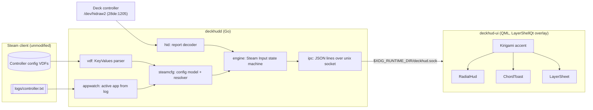

# deckhud: Implementation Plan

A transparent, click-through on-screen HUD for **Steam Input on KDE Plasma (Wayland)** on the Steam Deck.
It fills three gaps Steam leaves open in Desktop Mode:

1. **Radial menu HUD**: shows the radial menu and highlights the item the stick or trackpad points at. Steam draws this overlay in Game Mode (gamescope) but not in Desktop Mode.
2. **Key-chord feedback**: when a Deck button sends a keyboard/mouse binding (e.g. `R4 → Ctrl+Shift+T`), a short toast shows the button glyph and the keys it sent.
3. **Layer / action-set cheat sheet**: when an action layer or action set changes (or when held on demand), shows a diagram of the Deck controls with what each one is mapped to *right now*.

All overlays are translucent, never take focus or clicks, and are tinted with the **KDE accent colour**. They follow the colour live when it changes, including wallpaper-derived accents.

Scope is deliberately narrow: **Steam Deck (Neptune) controller + KDE Plasma 6 Wayland + SteamOS**. Other
controllers, desktops and X11 are non-goals for v1.

---

## Progress log

- **2026-10-30 (later):** M7 cheat sheet (engine snapshot, QML `LayerSheet`, `deckhudd peek`), accent via the XDG settings portal (Kirigami didn't follow slideshow accents), Flatpak packaging verified ([spike](research/flatpak-spike.md)), MIT licence, `v0.1.0` tag. Flathub submission dropped: its policy forbids AI-assisted manifests/submissions.
- **2026-10-30:** M1–M6 core landed (parser, config model, HID, engine, daemon, overlay). Still needs hand-checking on the Deck: back-button bit mapping, radial geometry and fire behaviour, long/double-press timing, click-through.

---

## 1. What we found on the target system (2026-10-30)

| Item | Finding | Consequence |
|---|---|---|
| OS / desktop | SteamOS (holo), Plasma **6.7.3**, KWin Wayland, Qt **6.11.1** | Target Qt 6.11 / KF6 APIs |
| Layer shell | `/usr/lib/qt6/qml/org/kde/layershell` (LayerShellQt QML module) + `liblayer-shell.so` shell integration present | Overlay can be a `wlr-layer-shell` surface with **no compiled code**: plain QML run by the system `qml` runtime |
| QML tooling | `/usr/lib/qt6/bin/{qml,qmltestrunner,qmllint,qmlformat}` present; Kirigami present | UI and its tests run on the host with stock packages. Nothing needs installing into the read-only root |
| Accent colour | `~/.config/kdeglobals` → `[General] AccentColor=154,147,227`, `accentColorFromWallpaper=true` | Use `Kirigami.Theme.highlightColor`, which tracks accent changes live |
| Controller HID | `28de:1205` "Valve Software Steam Controller"; `/dev/hidraw0-2` readable by `deck` via logind `uaccess` ACL. **`hidraw2` streams 64-byte input reports (type `0x09`) while Steam is running**, read passively | We can see raw button/stick/trackpad state without root, udev rules or fighting Steam for the device |
| evdev | `event4/5` (Steam Controller, lizard-mode), `event6` (Steam's virtual X-Box 360 pad) readable. No Steam virtual keyboard node existed at idle | Key output can be *derived from config*; whether Steam creates a uinput keyboard on demand is a spike (§6) |
| Steam configs | `~/.local/share/Steam/steamapps/common/Steam Controller Configs/<uid>/config/` holds `configset_controller_neptune.vdf` (app → template/workshop/autosave) and per-app dirs. Desktop config = app **413080** | Parse Valve KeyValues (VDF) to learn action sets, layers, groups, radial menus, bindings, labels and icons |
| Active app | `~/.local/share/Steam/logs/controller.txt` logs `Queueing activation for controller: 15 app: 413080` | Tail the log to know which app's config is active (desktop vs a game launched from desktop) |
| Radial menu config | `"mode" "radial_menu"` groups with `touch_menu_button_N` inputs, bindings like `key_press LEFT_CONTROL, , ghost_045_move_0010.png, ` and settings `touchmenu_button_fire_type` | Labels and icons are in the config; icons resolve to `~/.local/share/Steam/tenfoot/resource/images/library/controller/binding_icons/*.png` |
| Toolchain | Go 1.27.3 via mise, `uv`, no host `gcc` | Daemon in **pure Go** (`CGO_ENABLED=0`), no cgo HID libraries |

---

## 2. Architecture

Two processes, joined by a local socket:

- **`deckhudd`** (Go): all the logic. Reads the controller, parses Steam configs, runs the Steam Input
  state machine, and emits high-level UI events. Fully unit-testable with no display.
- **`deckhud-ui`** (QML on the system Qt): a dumb view. Renders whatever the daemon says and owns no
  mapping logic beyond layout and animation.



### Why this split
- **Testability (TDD):** about 90% of the behaviour (parsing, decoding, layer stacks, radial geometry, chord
  formatting, timing of long/double press) is pure Go fed by fixtures and a fake clock.
- **No compilation for the UI:** the system already ships LayerShellQt QML + Kirigami matched to its own Qt.
  Bundling our own Qt, as PySide6 would, risks a Qt-version mismatch with the system's layer-shell plugin.
- **Immutable-root friendly:** a static Go binary in `~/.local/bin`, QML in `~/.local/share/deckhud`, and a
  systemd **user** unit. No pacman, no root, no udev rules (hidraw access already works through `uaccess`).

### We *replicate* Steam's state; we don't query it
Steam has no supported desktop API for "current layer / radial highlight". So the daemon re-runs the
relevant part of Steam Input from the **same config + same raw input** Steam sees. This is deterministic
and testable, but it can drift (see Risks §7). A later optional phase can add an authoritative source.

---

## 3. Repository layout (target)

```
deckhud/
├── cmd/deckhudd/            # daemon entrypoint (+ `record`, `replay`, `dump-config` subcommands)
├── internal/
│   ├── vdf/                 # Valve KeyValues text parser (ordered, duplicate keys preserved)
│   ├── steamcfg/            # locate userdata, resolve active config, typed model
│   ├── binding/             # parse "key_press X", "controller_action add_layer 3", labels/icons
│   ├── hid/                 # Neptune report 0x09 decoder + hidraw device discovery/reader
│   ├── engine/              # activators, action sets, layer stack, radial selection, chords
│   ├── appwatch/            # tail controller.txt → active appid
│   ├── keyfmt/              # Steam key names → human/KDE-style labels ("Ctrl+Shift+T")
│   └── ipc/                 # event schema + unix-socket server
├── ui/
│   ├── main.qml             # LayerShell window(s), socket client
│   ├── components/          # RadialHud.qml, ChordToast.qml, LayerSheet.qml, Glyph.qml
│   ├── glyphs/              # original SVG button glyphs (A/B/X/Y, L1…R5, sticks, pads, …)
│   └── tests/               # tst_*.qml for qmltestrunner
├── testdata/
│   ├── vdf/                 # real configs (copied from this Deck) + hand-written edge cases
│   ├── hid/                 # recorded report streams (.bin + .json annotations)
│   └── golden/              # expected engine event streams
├── packaging/systemd/       # deckhudd.service, deckhud-ui.service (PartOf plasma-workspace.target)
├── mise.toml                # go, golangci-lint, task definitions
└── docs/PLAN.md
```

---

## 4. TDD strategy

**Rule:** no production code without a failing test first. Each feature lands as red → green → refactor
commits.

| Layer | Tooling | How |
|---|---|---|
| Go units | `go test ./...` (+ `-race`), table-driven | Parser edge cases, binding grammar, report decoding with crafted byte arrays, engine with a **fake clock** |
| Fixtures from reality | `deckhudd record` writes raw hidraw reports with timestamps; `testdata/vdf` holds real configs | Tests replay *actual* Deck input. Any bug becomes a recorded fixture plus a failing test |
| Golden files | `engine` replays `hid` stream + config → event JSONL, compared to `testdata/golden/*.jsonl` (`-update` flag to regenerate) | Locks down end-to-end behaviour without a screen |
| IPC contract | Go tests on schema + a JSON schema file shared with QML tests | Daemon and UI can't drift silently |
| QML units | `qmltestrunner` with `QT_QPA_PLATFORM=offscreen`, `TestCase` + `SignalSpy` | Radial geometry → highlighted wedge, toast queueing/expiry, sheet layout, accent tinting |
| Lint | `go vet`, `golangci-lint`, `qmllint`, `qmlformat --check` | Run in `mise run check` |
| Manual acceptance | Checklist in `docs/ACCEPTANCE.md` run on the Deck | The parts CI can't see: layer-shell stacking, click-through, fullscreen apps, touchscreen still usable |
| CI | GitHub Actions: Go tests on ubuntu; QML tests in an Arch container with `qt6-declarative kirigami layer-shell-qt` | Arch matches SteamOS's package base most closely |

`mise` tasks: `test`, `test:go`, `test:qml`, `check`, `run:daemon`, `run:ui`, `record`, `install`.

---

## 5. Milestones

Each milestone is a small, demoable vertical slice. Checkboxes become GitHub issues.

### M0: Spikes (time-boxed, throwaway code, findings recorded in `docs/research/`)
- [x] **Overlay spike** ([findings](research/overlay-spike.md)): QML `Window` + `LayerShell.Window` (layer `LayerOverlay`, `keyboardInteractivity: None`,
      `Qt.WindowTransparentForInput`), run via `/usr/lib/qt6/bin/qml`. Confirm transparency, click-through,
      stays above fullscreen apps, no focus steal, and that the touchscreen and pointer pass through.
- [ ] **HID spike:** document the report `0x09` byte layout (buttons bitmask incl. L4/L5/R4/R5/QAM/…,
      sticks, trackpads, triggers, stick/pad touch bits). Confirm reading never disturbs Steam.
      Confirm which interface/hidraw node carries reports and that it's stable across reboots.
- [ ] **Radial geometry spike:** with a known test config, record which item fires at which angle.
      Pin down item 1 position, direction, wedge width, deadzone, stick vs trackpad, and the meaning of
      `touchmenu_button_fire_type` and the related settings.
- [ ] **Config resolution spike:** map `configset_controller_neptune.vdf` entries
      (`template "CLOUD_413080/…"`, `workshop`, `autosave`) to the file Steam actually loads.
      Confirm `controller.txt` reliably reports app switches (desktop ↔ game ↔ Steam UI `769`).
- [ ] **Virtual keyboard spike:** does Steam create a uinput keyboard/mouse when a key binding fires?
      If yes, it is an optional ground-truth source for chords.

### M1: Config model
- [x] `vdf` parser: quoted/unquoted tokens, escapes, `//` comments, `#include`/`#base`, duplicate keys, ordering
- [x] `binding` grammar: `key_press`, `mouse_button`, `mouse_wheel`, `xinput_button`, `controller_action …`
      (`add_layer`, `hold_layer`, `remove_layer`, `change_preset`, `SHOW_KEYBOARD`, …), label + icon fields
- [x] `steamcfg`: presets (action sets), action layers, `group_source_bindings` (incl. `active`/`inactive`/modeshift),
      groups by mode (`four_buttons`, `dpad`, `radial_menu`, `touch_menu`, `joystick_move`, `trigger`, …)
- [x] Resolver: userdata id → active desktop config (and per-app configs); `dump-config` CLI prints the model

### M2: Controller input
- [x] `hid` decoder (pure function: `[]byte → State`) tested with recorded reports
- [ ] Device discovery by VID/PID + usage page, reconnect on suspend/resume
- [x] `record` subcommand (`replay` still to do)

### M3: Engine
- [x] Activators: `Full_Press`, `Start_Press`, `Release_Press`, `Long_Press`, `Double_Press` on an injectable clock
- [ ] `chord` activators, trigger soft-press, trackpad radial menus
- [x] Action set switching and **layer stack** (add/hold/remove), with source-binding overrides per layer
- [x] Radial menu: open/close, per-frame highlight index, fired item
- [x] Chord events: button → resolved bindings → `{"glyph":"R4","keys":["Ctrl","Shift","T"],"label":"…"}`
- [ ] Golden replay tests for each behaviour

### M4: Daemon + IPC
- [x] `appwatch` (tail log, handle rotation), config hot-reload via fsnotify
- [x] JSON event protocol v1 (over a token-guarded loopback **WebSocket**, since QML has no Unix-socket client) (`hello`, `radial.open/highlight/close`, `chord`, `layer.changed`,
      `actionset.changed`, `sheet.show/hide`, `config.reloaded`)
- [x] systemd user unit; only active in Plasma sessions (Game Mode already has Steam's own overlay)

### M5: Radial HUD (first user-visible feature)
- [x] `RadialHud.qml`: translucent accent-tinted ring, wedge per item, label + Steam binding icon,
      animated highlight, "fired" flash, positioned per config (or centred)
- [x] QML tests for wedge maths and highlight state

### M6: Chord toasts
- [x] `ChordToast.qml`: glyph + key caps, stacking/queueing, configurable timeout and screen corner
- [x] Coalesce repeats (holding a button doesn't spam), hide while a radial menu is open

### M7: Layer / action-set cheat sheet
- [x] `LayerSheet.qml`: Deck outline with callouts for every mapped control in the current layer
- [x] Shows briefly on layer/action-set change; **hold-to-show** chord (configurable) to peek at any time
- [x] Highlights what changed relative to the base layer

### M8: Polish & release
- [ ] Settings file (`~/.config/deckhud/config.toml`): enable/disable features, opacity, scale, positions,
      timeouts, peek chord
- [ ] `mise run install`/uninstall; survives SteamOS updates (everything lives under `$HOME`)
- [ ] README with screenshots/GIFs, `docs/ACCEPTANCE.md`, v0.1.0 release with a static binary

### Later / optional
- Authoritative state via Steam's CEF debugging bridge (how Decky Loader reads `SteamClient.Input`), to
  correct drift. Opt-in, because it is unofficial and fragile.
- Trackpad touch menus (`touch_menu` mode) using the same HUD
- Multi-monitor placement (follow the focused output)

---

## 6. Overlay design notes

- **Window:** one full-screen `LayerShell.Window` on the `Overlay` layer, anchored to all edges,
  `exclusionZone: -1`, empty input region. The three components are children that fade in and out, so
  there's only one surface to manage.
- **Colour:** `Kirigami.Theme.highlightColor` as the tint at about 35–55% alpha, with a darker translucent
  backdrop for contrast and text in `Kirigami.Theme.highlightedTextColor`. Re-evaluated live because
  Kirigami re-emits on `kdeglobals` change.
- **Glyphs:** our **own** SVG glyph set for Deck controls (no redistribution of Valve artwork). Radial items
  may show the user's *local* Steam binding icons at runtime, loaded from their Steam install and never
  committed.
- **Performance:** the HUD idles at 0% CPU and renders only while visible. The daemon reads hidraw at the
  device rate (~250 Hz) but sends only *changes* to the UI, throttled to the display refresh.

---

## 7. Risks & mitigations

| Risk | Impact | Mitigation |
|---|---|---|
| Undocumented, evolving VDF schema | Mis-parsed bindings | Fixtures from real configs; unknown modes/actions degrade to "show raw binding text", never crash |
| Replicated state drifts from Steam (e.g. a layer changed via QAM, missed press during suspend) | Wrong sheet/labels | Reset on app/action-set change from `controller.txt`; reset on resume; peek chord re-syncs; later CEF bridge |
| Radial selection maths differs subtly from Steam's | Highlight disagrees with what fires | M0 geometry spike + recorded golden tests; "fired" event confirmed against the chord output |
| Steam changes HID handling or permissions | No input | Discovery + clear error in UI; evdev fallback for buttons only |
| KWin layer-shell behaviour changes | Overlay hidden or steals input | Manual acceptance checklist per Plasma update |
| Steam UI (app 769) or game configs active on desktop | Wrong mapping shown | `appwatch` switches model per active app; hide when the config can't be resolved |

---

## 8. Definition of done (v0.1)

- In Desktop Mode, using a radial menu shows an accent-coloured radial HUD whose highlight matches the item
  Steam fires, in the recorded tests and by hand.
- Pressing a button bound to a key combo shows a toast like `[R4] Ctrl + Shift + T` within one frame.
- Switching layers shows the cheat sheet, and the peek chord shows it on demand.
- Overlay never steals focus or clicks, and survives Plasma restart, suspend/resume and SteamOS updates.
- `mise run test` is green locally and in CI.
